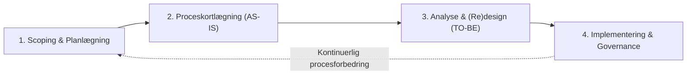
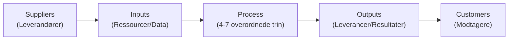
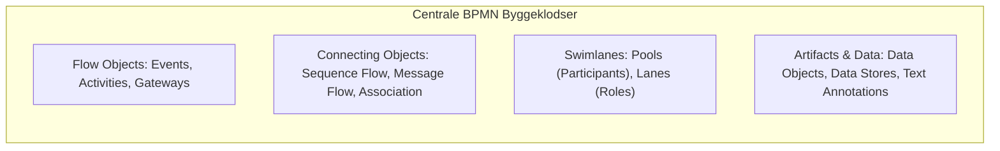
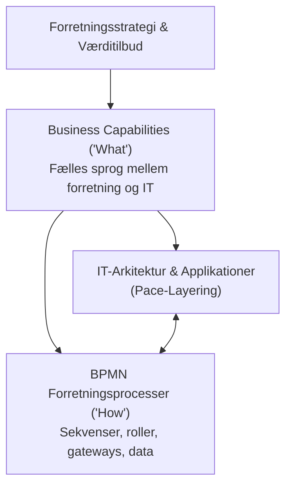
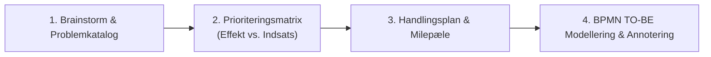

## Business Process Management & BPMN 2.0 – Komplet Faglig Syntese & Nøglenoter

> [!abstract] Resumé & Relevans for Læringsmål
> Denne studienote samler pensums samlede teoretiske, metodiske og arkitektoniske grundlag for procesledelse og procesmodellering i **Business Process Model and Notation (BPMN 2.0)**. Noten integrerer Bruce Silvers *Method and Style*, BPM-livscyklussen (Harmon/OMG), Lean-procesanalyse (SIPOC og 5 Whys), Enterprise Architecture-roller (SAP LeanIX og Dansk IT) samt overgangen fra AS-IS til TO-BE procesoptimering via forretningskapabiliteter, gapanalyse og digital modenhed (Kræmmergaard).
> 
> **Relevans for Læringsmål:**
> * **Læringsmål A (Muligheder og begrænsninger for digital transformation):** Noten belyser, hvordan IT-arkitekturens lagdeling (Pace-Layering: System of Record vs. Engagement Platform) og organisationens digitale modenhedstrin (Generation 1–5) sætter de strukturelle rammer for, hvad der kan automatiseres og digitaliseres.
> * **Læringsmål F (Kortlægning af eksisterende forretningsproces vha. BPMN AS-IS):** Noten opstiller den formelle syntaks, semantik og modelleringsstil for BPMN 2.0 (Descriptive Level 1 og Analytic Level 2) samt metoden til gennemførelse af scoping, SIPOC og AS-IS workshops.
> * **Læringsmål G (Forretningskapabiliteter og gap-analyse):** Noten definerer begrebet forretningskapabiliteter (*"What"*) i kontrast til forretningsprocesser (*"How"*), gennemgår principperne for Capability Mapping og forklarer den strategiske gapanalyse (Performance Gaps vs. Opportunity Gaps).
> * **Læringsmål H (Optimerede digitale forretningsprocesser TO-BE):** Noten gennemgår den strukturerede metode til TO-BE procesdesign via problem- og idékatalog, prioritering i effekt/indsats-matricer samt annotering af systemgrænser, datainputs og automatiserede forretningsregler.
> * **Læringsmål L (Formidling af procesanalyse og løsningsforslag):** Noten etablerer det stringente faglige begrebsapparat, der gør det muligt at kommunikere procesarkitektur entydigt til både forretningsmæssige og tekniske interessenter.

---

### Nøglebegreber & Definitioner

*   **BPMN 2.0 (Business Process Model and Notation)** : En global, ISO-standardiseret grafisk notation og formel metamodel forvaltet af Object Management Group (OMG). BPMN bygger bro mellem forretningsanalyse og teknisk implementering ved at levere et fælles, entydigt sprog, der repræsenteres grafisk (Notation) og eksekverbart (Metamodel i XML).
*   **Business Process Management (BPM)** : En helhedsorienteret ledelsesdisciplin og procesorienteret styringsmodel, hvor en organisation systematisk designer, kortlægger, analyserer, forbedrer og styrer sine arbejdsprocesser end-to-end for at optimere ressourceudnyttelse, kvalitet og kundeværdi.
*   **BPMN Method and Style** : En normativ metodik formuleret af Bruce Silver. Metodikken fastslår, at overholdelse af OMG-specifikationens grundregler (*validitet*) ikke er tilstrækkeligt; procesmodeller skal også følge faste stilregler (*clarity, completeness, consistency*), så proceslogikken kan aflæses entydigt direkte af diagrammet uden behov for supplerende prosatekst.
*   **Proces (Process)** : En afgrænset sekvens af koordinerede aktiviteter, gateways og hændelser, der udløses af en specifik start-trigger og fører frem til en veldefineret slutstatus. En proces er instansbaseret, diskret og gentagelig.
*   **Orkestrering (Orchestration)** : Den eksplicitte, forudbestemte proceslogik for en given procesinstans inden for en afgrænset organisatorisk styringsgrænse (repræsenteret ved én Pool). I en orkestrering er samtlige mulige forløbsveje og betingelser defineret på forhånd.
*   **Kollaboration (Collaboration)** : Et overordnet BPMN-diagram, der modellerer interaktionen mellem to eller flere uafhængige processer eller eksterne forretningsenheder (f.eks. kunde, leverandør, tredjeparts-service) ved hjælp af Message Flows på tværs af separate Pools.
*   **AS-IS Procesmodel** : Den faktuelle, nøgterne kortlægning af organisationens nuværende proces, præcis som den afvikles i praksis (inklusiv manuelle omveje, flaskehalse, redundans og fejltrin), uden forskønnelse eller indblanding af fremtidige ønsker.
*   **TO-BE Procesmodel** : Det redesignede, optimerede og digitaliserede fremtidsscenarie for processen, hvor identificeret spild er elimineret, flaskehalse er opløst, og aktiviteter er effektiviseret via systemintegration, automatisering og datastøtte.
*   **Business Capability (Forretningskapabilitet)** : En organisations overordnede evne til at udføre en kernefunktion eller opnå et strategisk resultat (*"What"*). Kapabiliteter udgør den stabile forretningsarkitektur uafhængigt af, hvilke konkrete processer, IT-systemer eller medarbejdere der udfører arbejdet.
*   **Business Process vs. Capability** : Processen definerer sekvensen, aktørerne, gateways og flows (*"How"*), mens kapabiliteten definerer selve evnen og det forretningsmæssige formål (*"What"*). Flere processer kan realisere den samme kapabilitet.
*   **SIPOC (Suppliers, Inputs, Process, Outputs, Customers)** : Et makro-proceskortlægningsværktøj anvendt i DMAIC-metodens *Define*-fase. Værktøjet fastlægger procesafgrænsningen (scope), inputs/outputs og centrale leverandører/kunder, før der udarbejdes detaljerede swimlane-diagrammer.
*   **5 Whys (Root Cause Analysis)** : En iterativ spørgeteknik med rødder i Toyota Production System (TPS). Ved at spørge "Hvorfor?" mindst 5 gange dykker man bag om overfladiske symptomer for at identificere den grundlæggende rodårsag til procesfejl eller spild.
*   **RACI-matrix** : En ansvarsfordelingsmodel anvendt til procesgovernance, bestående af *Responsible* (den udførende), *Accountable* (den endeligt ansvarlige/godkenderen), *Consulted* (faglig ekspert, der høres tovejs) og *Informed* (interessent, der orienteres envejs).
*   **Descriptive Subclass (Level 1 Palette)** : Den basale delmængde af BPMN 2.0-elementer (tasks, exclusive/parallel gateways, none/message/timer start- og end-events, pools, lanes, sekvens- og beskedflows samt dataobjekter), som anvendes til overordnet procesbeskrivelse for forretningsbrugere.
*   **Analytic Subclass (Level 2 Palette)** : Den udvidede delmængde af BPMN 2.0, der tilføjer detaljeret hændelseshåndtering (intermediate catching/throwing events, boundary interrupting/non-interrupting events for Timer, Message og Error), som specificerer procesadfærd under afvigelser og undtagelser.
*   **Gap Analyse** : En systematisk metode til at sammenholde en organisations aktuelle præstation og kapabiliteter (Current State) med dens ønskede fremtidige strategiske mål (Desired State) for at identificere og lukke forretningsmæssige gab. Opdeles i *Performance Gaps* (underpræstation mod eksisterende mål) og *Opportunity Gaps* (manglende evne til at gribe nye digitale markedsmuligheder).
*   **Pace-Layered IT-arkitektur** : En arkitektonisk lagdelingsmodel (Gartner / Kræmmergaard), der inddeler organisationens applikationer i tre lag efter forandringshastighed: *System of Record* (dyb kælder: stabil kernedrift/ERP), *System of Differentiation* (differentierende forretningssystemer) og *System of Innovation* (agile, udadvendte engagement-platforme og apps).

---

### Dybdegående Gennemgang

#### 1. Business Process Management (BPM) som Ledelsesramme

##### 1.1 BPM-Livscyklussens 4 Faser
Business Process Management (BPM) betragter organisationen som et sammenhængende netværk af processer frem for isolerede afdelingssiloer. BPM-metoden udfolder sig i en kontinuerlig 4-trins livscyklus:

1.  **Fase 1: Scoping og planlægning**:
    *   Formålet med procesanalysen defineres, og proceskonsulentens/analytikerens mandat fastlægges.
    *   Relevante forretningsprocesser udvælges med afsæt i virksomhedens forretningsmodel (f.eks. Business Model Canvas) og strategiske mål.
    *   Procesejeren identificeres, og succeskriterier afstemmes.
    *   Nøgleinteressenter og deltagere til kortlægningsworkshops fastlægges.
2.  **Fase 2: Proceskortlægning (AS-IS)**:
    *   Den eksisterende arbejdsproces dokumenteres objektivt gennem workshops med faglige domæneeksperter (SME), suppleret med interviews og observationer.
    *   Kortlægningen fanger processekvenser, aktørroller, anvendte IT-systemer, dataudveksling samt konkrete flaskehalse og frustrationer.
3.  **Fase 3: Analyse og (re)design (TO-BE)**:
    *   AS-IS modellen tryktestes for spild (Lean-analyse), procesbrud og rodårsager til fejl (5 Whys).
    *   Nye servicemål, kundekrav og digitaliseringspotentialer defineres.
    *   Fremtidige procesmodeller (TO-BE) designes og annoteres med automatiserede regler og systemgrænser.
4.  **Fase 4: Implementering og governance**:
    *   Nye processer udrulles i organisationen understøttet af forandringsledelse og uddannelse.
    *   Der etableres procesejerskab og monitorering via KPI'er for at sikre procesoverholdelse og løbende optimering.

> [!tip] Underviserens fokus: Processernes placering i forretningsmodellen
> I Business Model Canvas (BMC) udgør processerne selve bindemidlet. Hvor canvassets Frontstage beskriver værditilbud og kundesegmenter, og Backstage beskriver nøgleressourcer og partnere, udgør processerne den operationelle motor i **Nøgleaktiviteter (Key Activities)**, der forbinder ressourcer med værdileverancen.

##### 1.2 Porters Værdikæde & Proceskategorier
I procesarkitekturen klassificeres samtlige forretningsprocesser efter Michael Porters værdikædemodel:
*   **Kerneprocesser (Core Processes)** : De primære værdiskabende processer, som har direkte snitflade til kunden og genererer virksomhedens omsætning (f.eks. lead-to-quote, order-to-cash, produktionsflow, kundeservice).
*   **Støtteprocesser (Support Processes)** : Interne processer, der stiller de nødvendige ressourcer og infrastrukturen til rådighed for kerneprocesserne (f.eks. rekruttering/HR, IT-drift, bygningsadministration, regnskab).
*   **Ledelsesprocesser (Management Processes)** : Overordnede styrings- og kontrolprocesser, som sætter mål, rammer og retningslinjer for hele organisationen (f.eks. strategisk planlægning, Enterprise Architecture governance, risikostyring, budgettering).

##### 1.3 IT-Arkitekturroller i Procesledelse
Samspillet mellem forretningsprocesser og teknologi varetages af specialiserede arkitektroller:

| Arkitektrolle | Hovedfokus & Snitflade | Rolle i forhold til BPMN & Processer |
| :--- | :--- | :--- |
| **Business Architect (BA)** | Forretningsstrategi, forretningskapabiliteter og proceslandskab. Lavt teknologifokus, højt strategifokus. | Definerer strategiske forretningsprocesser og kapabiliteter; opstiller kravene til procesændringer (AS-IS og TO-BE) i samarbejde med forretningen. |
| **Enterprise Architect (EA)** | Tværgående overblik over applikationsportefølje, teknologistak og integrationsmønstre (TOGAF). | Sikrer, at processerne understøttes af en sammenhængende IT-arkitektur uden redundans, og afdækker teknologiske gabs. |
| **Solution Architect (SA)** | Konkret løsningsdesign for et specifikt projekt eller forretningsdomæne. | Oversætter forretningskrav og procesdiagrammer til konkrete softwaresystemer, integrationsflader og databasedesign. |
| **Technical Architect (TA)** | Dybdegående teknisk ekspertise inden for infrastruktur, kodeplatforme, cloud og deployment. | Implementerer den faktiske kode, API'er, mikrotjenester og workflow-motorer, der eksekverer automatiserede processer. |

---

#### 2. Forberedelse, Scoping & AS-IS Procesanalyse

##### 2.1 Scoping af Processen
Før der tegnes et eneste BPMN-symbol, skal analyseområdet afgrænses skarpt for at undgå at drukne i proceskompleksitet. Ved hjælp af et struktureret scoping-skema indsamles følgende stamdata:
*   **Procesnavn**: Angivet som en aktiv handling (f.eks. *Reklamationshåndtering*).
*   **Start-trigger**: Hvilken specifik hændelse igangsætter processen (f.eks. *Modtagelse af skriftlig klage fra kunde*)?
*   **Slut-tilstand**: Hvad kendetegner en afsluttet proces (både succesfuld løsning og afvisning)?
*   **Volumen & Frekvens**: Hvor mange sager behandles pr. dag/uge/måned, og hvornår forekommer spidsbelastninger?
*   **Direkte aktører**: Hvilke interne og eksterne roller er involveret i udførelsen?

##### 2.2 SIPOC: Makro-proceskortlægning
SIPOC etablerer det overordnede procesoverblik (*helicopter view*) før detaljeret swimlane-modellering. Modellen opdeles i fem vertikale søjler:

I Lean-analyse anvendes procesfeltet i SIPOC til at farvekode procesaktiviteter:
*   **Grøn (Value Added / VA)**: Aktiviteter, der direkte transformerer inputtet til noget, kunden vil betale for eller oplever som værdiskabende.
*   **Gul (Necessary Non-Value Added / NNVA)**: Aktiviteter, der ikke tilfører direkte værdi for kunden, men som er uundgåelige pga. lovkrav, compliance, sikkerhed eller nuværende systembegrænsninger (Muda Type 1).
*   **Rød (Non-Value Added / NVA)**: Rent spild, unødvendige ventetider, dobbeltindtastning og omarbejde, som straks bør elimineres (Muda Type 2).

##### 2.3 Lean Spildanalyse & 5 Whys Root Cause Analysis
Ved overgangen fra AS-IS analyse til TO-BE optimering anvendes Lean-værktøjskassen til at diagnosticere processygdomme:
*   **De 7+1 former for spild (Muda)**:
    1.  *Overproduktion*: At udføre arbejde, der ikke efterspørges aktuelt.
    2.  *Ventetid*: Stillestående sager, der venter på godkendelse, information eller batchafvikling.
    3.  *Unødig transport*: Fysisk eller digital flytning af sager mellem lokationer/systemer.
    4.  *Overforædling (Inappropriate processing)*: Mere komplekse godkendelser eller kontroller end nødvendigt.
    5.  *Lagring (Inventory)*: Bunker af ubehandlede sager, ubesvarede mails eller fyldte indbakker.
    6.  *Unødige bevægelser*: Medarbejdere, der skifter mellem talrige IT-systemer eller leder efter information.
    7.  *Defekter & fejl*: Mangelfulde data, der kræver afklaring, rettelse og omarbejde.
    8.  *Uudnyttet medarbejderpotentiale*: Rutinearbejde, der forhindrer faglig opgavevaretagelse.
*   **5 Whys problemløsningsmetode**:
    *   Hver gang et problem eller et spildpunkt identificeres i processen, stilles spørgsmålet *"Hvorfor skete dette?"*.
    *   Svaret danner grundlag for det næste *"Hvorfor?"*, indtil den strukturelle rodårsag (f.eks. manglende validering i frontend eller uklar ansvarsfordeling) er blotlagt.

##### 2.4 Facilitering af AS-IS Workshop
Kortlægningen af AS-IS processer kræver en stringent faciliteringsmetode for at adskille fakta fra holdninger:
*   **Facilitator vs. Domæneekspert**: Facilitatoren styrer procesmetoden, stiller åbne spørgsmål og håndhæver BPMN-syntaksen. Domæneeksperterne (SME) leverer det faglige indhold om, hvad der reelt sker i hverdagen.
*   **Happy Flow ("Ja-flow") først**: Man starter altid med at kortlægge den mest almindelige, fejlfrie vej gennem processen (som typisk dækker 80 % af tilfældene). Først når happy flow er valideret, tilføjes varianter, undtagelser og fejlforløb.
*   **Spørgeteknik**: Der benyttes åbne hv-spørgsmål (*"Hvad trigger dette trin?"*, *"Hvem udfører opgaven?"*, *"Hvilket system anvendes?"*, *"Hvad sker der, hvis oplysningerne mangler?"*).
*   **Parkering af emner (Parking Lot)**: Idéer til TO-BE løsninger, politiske diskussioner eller dybe IT-problemer "parkeres" på en separat tavle, så workshoppen fastholder fokus på den faktiske AS-IS tilstand.
*   **RACI-forankring**: Roller defineres via svømmebaner (Lanes) for at sikre, at ansvar og opgaveudførelse er fuldstændig gennemskuelig.

---

#### 3. BPMN 2.0: Syntaks, Regler og Bruce Silvers Method & Style

##### 3.1 Historisk Udvikling & Standardens Opbygning
BPMN blev oprindeligt skabt som en ren grafisk notation (BPMN 1.x). Med frigivelsen af **BPMN 2.0** i 2010 under OMG blev notationen integreret med en formel underliggende metamodel og et XML-udvekslingsformat. Dermed skelnes der mellem:
*   **The N (Notation)**: De visuelle grafiske former, ikoner og pile, som mennesker læser og forstår.
*   **The M (Metamodel)**: Den underliggende formelle semantik og XML-struktur, der muliggør direkte import/eksport mellem modelleringsværktøjer (f.eks. Signavio, Camunda, FigJam) og udførelse i procesmotorer.

##### 3.2 Bruce Silvers Method & Style: De 4 Principper
Bruce Silver fastslår, at de officielle BPMN-regler kun forholder sig til teknisk syntaks (*spec correctness*), hvilket ofte fører til rodede og tvetydige modeller (*"Bad BPMN"*). For at skabe *"Good BPMN"* skal modeller opfylde fire kvalitetskriterier:
1.  **Correct**: Modellen overholder alle formelle syntaksregler i OMG BPMN 2.0-specifikationen.
2.  **Clear**: Proceslogikken skal være entydig og umiddelbart forståelig udelukkende ud fra diagrammet – uden at læseren skal gætte eller læse eksterne manualer.
3.  **Complete**: Diagrammet viser alle mulige start-triggers, samtlige væsentlige end-states (både succes- og fejludfald) samt al relevant kommunikation med eksterne parter.
4.  **Consistent**: Ensartede forretningsscenarier modelleres på samme strukturelle måde på tværs af hele organisationen, hvilket muliggør genbrug og standardiseret procesforståelse.

##### 3.3 Proceselementernes Anatomi: Descriptive (Level 1) & Analytic (Level 2)

###### A. Svømmebaner (Pools og Lanes)
*   **Pool**: Repræsenterer en uafhængig forretningsentitet eller procesgrænse.
    *   *White-box (Process Pool)*: Viser den interne proceslogik (aktiviteter, gateways, flows). Skal navngives med selve processens navn.
    *   *Black-box Pool*: En tom pool uden synlige interne aktiviteter, som repræsenterer en ekstern aktør (f.eks. *Kunde*, *Leverandør*, *Bank*). Anvendes til at vise snitflader via Message Flows.
*   **Lane**: En underopdeling af en White-box Pool, der specificerer den organisatoriske rolle, afdeling eller det system, der udfører aktiviteterne i banen (f.eks. *Kasserer*, *Sagsbehandler*, *Automatiseret System*).
    *   *Modelleringsregel*: Sequence Flows må frit krydse grænser mellem Lanes inden for den samme Pool, men må **aldrig** krydse en Pool-grænse.

###### B. Forbindelseslinjer (Connecting Objects)
*   **Sekvensflow (Sequence Flow)** : En ubrudt, fuldt optrukken linje med lukket pilespids. Viser den tidsmæssige og logiske rækkefølge af handlinger inden for én Pool.
    *   *Regel*: Skal forbinde flow-knudepunkter (aktivitet til gateway, gateway til event osv.). Må aldrig have åbne ender.
*   **Beskedflow (Message Flow)** : En stiplet linje med en åben cirkel ved startpunktet og en åben pilespids ved modtageren. Repræsenterer en asynkron eller synkron informationsudveksling mellem to separate Pools.
    *   *Regel*: Må **aldrig** forbinde to elementer inden for samme Pool. Må ikke kobles på kanten af en White-box pool, men skal ramme en specifik aktivitet, et besked-event eller en Black-box pool.
*   **Association**: En fin, prikket linje uden pil (eller med åben pil for dataflow). Knytter dataobjekter, datastores eller tekstannoteringer til proceselementer uden at påvirke procesforløbet.

###### C. Aktiviteter (Activities: Tasks og Subprocesses)
En aktivitet angiver en diskret arbejdshandling og tegnes som et afrundet rektangel:
*   **Task (Opgave)**: En atomær handling, der ikke nedbrydes yderligere i modellen. Silver foreskriver standardiserede opgavetyper:
    *   *User Task* (person-ikon): En opgave udført af et menneske ved hjælp af en IT-applikation.
    *   *Manual Task* (hånd-ikon): En fysisk, rent manuel opgave uden IT-interaktion.
    *   *Service Task* (tandhjuls-ikon): En fuldautomatisk softwarehandling (f.eks. kald til et API eller backend-beregning).
    *   *Business Rule Task* (tabel-ikon): Automatisk evaluering af forretningsregler i en regelsystemsmotor.
    *   *Send Task / Receive Task*: Dedikerede opgaver til at afsende eller afvente en besked.
*   **Subprocess (Underproces)**: En sammensat aktivitet, hvis interne proceslogik er defineret som en underliggende procesmodel.
    *   *Collapsed Subprocess*: Vises i forældrediagrammet som en task med et lille `[+]` symbol i bunden. Den detaljerede sekvens er gemt i et separat diagram.
    *   *Expanded Subprocess*: Den underliggende proces vises integreret inde i den forstørrede afrundede boks i samme diagram.
    *   *Call Activity* (fed, tyk ramme): En genanvendelig, global procesdefinition, der kan kaldes på tværs af flere forskellige procesmodeller (f.eks. en generisk fakturerings- eller loginproces).
    *   *Regel for Subprocesser*: En subprocess må kun have en *None Start Event* (uden trigger-ikon), da den igangsættes af det indgående sekvensflow, og sekvensflows må aldrig krydse subprocessens ydre ramme direkte.

###### D. Gateways (Forgreninger og Samlinger)
En gateway (rombeform) styrer flowets divergens (Split) og konvergens (Join):
*   **Exclusive Gateway (XOR)** :
    *   *XOR-Split*: Præcis én af de udgående grene vælges baseret på en gensidigt udelukkende betingelse.
    *   *XOR-Join*: Fletter alternative grene sammen uden at vente på hinanden. Så snart ét token ankommer, fortsætter processen.
*   **Parallel Gateway (AND)** :
    *   *AND-Split*: Samtlige udgående grene aktiveres samtidigt og afvikles parallelt. Betingelser må **ikke** skrives på udgående flows.
    *   *AND-Join (Synkronisering)*: Venter på, at samtlige indgående parallelle grene er fuldført, før flowet føres videre. Det er en alvorlig fejl at udelade en AND-join, da aktiviteter efterfølgende ellers vil blive eksekveret flere gange utilsigtet.
*   **Inclusive Gateway (OR)** : Én eller flere grene kan vælges baseret på uafhængige betingelser. Ved join synkroniseres kun de grene, der faktisk blev aktiveret ved split.

###### E. Hændelser (Events)
Hændelser modellerer begivenheder, der sker momentant i eller omkring processen:
*   **Start Event (enkelt tynd ring)**:
    *   *None Start*: Udefineret eller manuel opstart (anvendes altid i subprocesser).
    *   *Message Start* (åben kuvert): Processen instantieres af en udefrakommende henvendelse.
    *   *Timer Start* (ur-ikon): Processen udløses af en tidsplan eller fast frekvens (f.eks. hver fredag kl. 12).
*   **Intermediate Event (dobbeltring)**: Indtræffer undervejs i procesforløbet.
    *   *Catching* (lyst/åbent ikon): Processen pauser og venter på, at hændelsen opstår (f.eks. afventer modtagelse af betaling eller et tidsudløb).
    *   *Throwing* (mørkt/udfyldt ikon): Processen udløser aktivt et signal eller afsender en besked.
    *   *Boundary Event*: Hæftes direkte på kanten af en aktivitet. Kan være *Interrupting* (afbryder opgaven øjeblikkeligt ved fejl/timeout) eller *Non-Interrupting* (stiplet dobbeltring: igangsætter en parallel procesvej, mens opgaven fortsætter).
*   **End Event (enkelt tyk ring)**:
    *   *None End*: Normal afslutning på en procesgren.
    *   *Message End* (udfyldt kuvert): Processen afsluttes med afsendelse af en bekræftelse/besked til en ekstern part.
    *   *Terminate End* (udfyldt sort cirkel): Afbryder øjeblikkeligt samtlige aktive tokens og parallelle forløb i hele procesinstansen.

##### 3.4 Bruce Silvers Stilregler for Navngivning og Layout
*   **Aktiviteter**: Skal altid navngives efter formlen **Aktivt Udsagnsord + Entydigt Navneord** i bydeform/infinitiv (f.eks. *"Opret kundeprofil"*, *"Udskriv fragtbrev"* – aldrig vage navne som *"Kundebehandling"*).
*   **Start Events**: Skal navngives med fortidig hændelse (f.eks. *"Ordre modtaget"* eller ved Message Start *"Modtag ordre"*).
*   **End Events**: Skal navngives med den resulterende sluttilstand (*State*) (f.eks. *"Ordre afsendt"*, *"Ansøgning afvist"*). Bruce Silver kræver en særskilt End Event for hver unik slutstatus for at gøre procesudfald målbare.
*   **Gateways**:
    *   XOR-Gateways bør navngives som et spørgsmål (f.eks. *"Godkendt?"*), og de udgående flows skal forsynes med klare svarmærkater (*"Ja"*, *"Nej"*).
    *   AND-Gateways må **aldrig** have betingelsestekst på de udgående grene, da alle grene altid aktiveres.
*   **Layout & Retning**: Flowet skal konsekvent bevæge sig fra **venstre mod højre** (tidsmæssig kronologi) og fra **top mod bund** ved organisatoriske overleveringer. Undgå krydsende sekvenslinjer og baglæns flows, medmindre der er tale om eksplicitte rework-loops.

---

#### 4. Fra AS-IS til TO-BE: Forretningskapabiliteter, Gap-Analyse & Digital Modenhed

##### 4.1 Business Capabilities vs. Business Processes ("What" vs. "How")
For at en digital procesoptimering (TO-BE) bliver strategisk forankret og langtidsholdbar, må organisationen adskille sit proceslag fra sit kapabilitetslag:

| Dimension | Business Capability (Forretningskapabilitet) | Business Process (Forretningsproces) |
| :--- | :--- | :--- |
| **Hovedspørgsmål** | **"What"** (Hvad skal virksomheden kunne?) | **"How"** (Hvordan udføres det i praksis?) |
| **Tidshorisont** | Meget stabil; ændrer sig sjældent over årtier. | Dynamisk og foranderlig; opdateres løbende. |
| **Abstraktionsniveau** | Konceptuelt og strategisk overblik. | Operationelt, sekventielt og teknisk detaljeret. |
| **Udførelse** | Uafhængig af organisation, roller og specifik IT. | Eksplicit knyttet til aktører, swimlanes, systemer og dataflows. |
| **Anvendelse** | Strategisk investeringsplanlægning, M&A, applikationsrationalisering. | Daglig drift, workflow-automatisering, Lean-optimering, instruktion. |

##### 4.2 Business Capability Mapping i Praksis
Et Capability Map opbygges hierarkisk:
*   *Level 1*: Overordnede forretningsdomæner (f.eks. *Customer Relationship Management*, *Supply Chain Management*, *Finance & Risk*).
*   *Level 2*: Konkrete underkapabiliteter (f.eks. *Lead Management*, *After Sales Service*, *Order Processing*).
*   *Level 3*: Specialiserede evner (f.eks. *Automated Credit Scoring*, *Digital Contract Signing*).
*   **Formål for Enterprise Arkitekten**:
    *   *Applikationsrationalisering*: Afdækker redundante IT-systemer, hvor flere afdelinger anvender forskellige systemer til at understøtte den samme kapabilitet.
    *   *Investeringsprioritering*: Synliggør, hvilke kapabiliteter der differentierer virksomheden på markedet (skal styrkes via innovation), og hvilke der er basale standarder (*commodities*, der bør standardiseres billigst muligt).

##### 4.3 Den Strategiske Gap-Analyse
Gapanalysen danner bro mellem den nuværende situation (Current State / AS-IS) og det fremtidige ambitionsniveau (Desired State / TO-BE):
1.  **Fastlæg fokusområde**: Udvælg de forretningsprocesser og kapabiliteter, der understøtter strategien.
2.  **Kortlæg Current State (AS-IS)**: Mål nuværende præstationer (gennemløbstid, fejl, manuelle timer).
3.  **Definer Desired State (TO-BE)**: Opstil målbare KPI'er og serviceniveauer.
4.  **Identificér Gabs**:
    *   *Performance Gap*: Virksomheden når ikke sine nuværende mål eller budgetter pga. ineffektivitet eller procesfejl.
    *   *Opportunity Gap*: Virksomheden mangler kapabiliteter til at udnytte nye markedsmuligheder eller digitale teknologier.
    > [!warning] Tushmans prioriteringsregel
    > En organisation skal altid lukke sine **Performance Gaps** gennem procesforbedring og udnyttelse af eksisterende ressourcer (*Exploit*), før den investerer massivt i at lukke **Opportunity Gaps** gennem radikal innovation og nye teknologier (*Explore*).
5.  **Kortlæg rodårsager**: Brug 5 Whys og Lean-spildanalyse.
6.  **Formulér handlingsplan**: Prioritér digitaliserings- og optimeringsinitiativer.
7.  **Eksekvér og monitorér**: Følg op på implementeringen mod de fastsatte KPI'er.

##### 4.4 Digital Modenhed (Kræmmergaards Generationstrappe 1–5)
Digitaliseringsgraden i en TO-BE proces afhænger af organisationens overordnede digitale modenhed:
*   **Generation 1 (Automatisering)**: IT erstatter manuelle rutiner en-til-en (f.eks. digital formular i stedet for papir). IT betragtes som en støttefunktion og omkostning.
*   **Generation 2 (Standardisering & Integration)**: Interne systemer integreres (f.eks. ERP-understøttelse), og processer optimeres via Lean. Fokus er på stabil infrastruktur og procesharmonisering.
*   **Generation 3 (Samskabelse & Nye services)**: Digitaliseringen flytter ud i kundegrænsefladen. Kunder inddrages via selvbetjeningsportaler og samarbejdsplatforme.
*   **Generation 4 (Økosystemer & Nye forretningsmodeller)**: Virksomheden kobler sine processer sammen med eksterne partnere i et åbent digitalt økosystem. IT er en integreret del af forretningsstrategien.
*   **Generation 5 (Hyperpersonalisering & AI)**: Avanceret anvendelse af prædiktive analyser, kunstig intelligens og realtidsdata til proaktivt at imødekomme brugerens behov ud fra livsbegivenheder, understøttet af stærk dataetik og transparens.

##### 4.5 IT-Arkitektur: Pace-Layering & Platforme
For at en TO-BE proces kan realiseres teknisk, skal processens IT-understøttelse placeres korrekt i den lagdelte arkitektur (Pace-Layering):
*   **System of Record (Kernesystemer / Dyb kælder)**:
    *   *Karakteristika*: Høj dataintegritet, transaktionssikkerhed, standardisering (ERP, finans, centrale registre). Lang levetid (10–20 år), langsom forandringshastighed.
*   **System of Differentiation (Differentieringslag / Øvre kælder)**:
    *   *Karakteristika*: Skræddersyede systemer og applikationer, der understøtter virksomhedens unikke forretningsprocesser og giver en konkurrencefordel. Middel levetid (3–7 år).
*   **System of Innovation (Innovations- & Engagementlag / Stueetage)**:
    *   *Karakteristika*: Hurtigt skiftende, modulære og udadvendte løsninger (mobilapps, portaler, AI-assistenter, IoT-dashboards). Meget kort levetid (måneder til få år), høj agilitet.
*   **Enterprise Platform vs. Engagement Platform**:
    *   *Enterprise Platform*: Den solide, indadvendte ryggrad, der garanterer stabil drift og overholdelse af governance i kerneprocesserne.
    *   *Engagement Platform*: Den fleksible, API-baserede grænseflade, der gør det muligt hurtigt at eksperimentere med nye brugerrejser og integrere eksterne partnere i TO-BE processen uden at kompromittere kernesystemerne.

##### 4.6 Gennemførelse af TO-BE Workshop & Annotering
Når fremtidige processer designes, anvendes en systematisk 4-trins workshopmetode:

1.  **Problem- og idékatalog**:
    Samtlige problemer, flaskehalse og spildpunkter fra AS-IS kortlægningen opstilles i en tabel:

| Problem (fra AS-IS) | Forretningsmæssig Konsekvens | Løsningsforslag / Digital idé (TO-BE) |
| :--- | :--- | :--- |
| *Manuel registrering og manglende integration* | *Forsinkelser, tastefejl, dobbeltarbejde* | *Automatiseret datafangst via webformular og direkte API-kald* |
| *Upræcis ansvarsfordeling i godkendelser* | *Sager strander; lang gennemløbstid* | *Eksplicitte godkendelses-gateways og automatiske notificeringer* |
| *Mangel på realtidsstatus* | *Kunder ringer gentagne gange; support overbelastes* | *Selvbetjeningsportal med automatisk statushåndtering via Message Events* |

2.  **Prioriteringsmatrix (Effekt vs. Indsats)**:
    Idéerne placeres i en 2x2-matrix:
    *   *Quick Wins (Høj effekt, lav indsats)*: Implementeres straks i første iteration af TO-BE modellen.
    *   *Strategiske projekter (Høj effekt, høj indsats)*: Kræver IT-arkitekturinvesteringer og fases ind i køreplanen.
    *   *Fyldkalk (Lav effekt, lav indsats)*: Udføres kun ved ledig kapacitet.
    *   *Undgå / Tidsrøvere (Lav effekt, høj indsats)*: Forkastes.
3.  **Struktureret Annotering i TO-BE Modellen**:
    I modelleringsværktøjer (f.eks. Camunda eller FigJam) annoteres procesmodellen for at gøre den implementerbar:
    *   *Systemgrænser*: Angivelse af, hvilke IT-systemer der udfører hvilke handlinger (anvendelse af Service Tasks vs. User Tasks).
    *   *Automatiserede forretningsregler*: Indsættelse af Business Rule Tasks, hvor regler er udskilt fra koden.
    *   *Datainputs og datastores*: Eksplicit angivelse af, hvor data læses fra og opdateres i (Data Stores).
    *   *Proces- og snitfladekald*: Anvendelse af Call Activities, hvor standardiserede mikroprocesser genbruges.

---

### Relevante Eksempler & Undervisers Cases

> [!example] Undervisers case: Pizzeria / Café bestillingsflow (Orbus Software)
> Underviserens gennemgang af bestillings- og leveranceflowet illustrerer, hvordan BPMN 2.0 orkestrerer en tværgående proces:
> *   **Kollaboration & Pools**: Processen viser samspillet mellem tre uafhængige Pools: *Kunde* (Black-box), *Pizzeria* (White-box procespool) og *Bank* (Black-box). Kommunikationen foregår udelukkende via Message Flows (kunde sender bestilling via besked; pizzeria sender betalingsanmodning til bank og modtager transaktionsbekræftelse).
> *   **Lanes for Rolleopdeling**: Pizzeria-poolen er opdelt i tre svømmebaner: *System* (automatiseret verificering og udskrivning), *Køkken* (tilberedning) og *Udbringer/Kasserer* (pakning og levering).
> *   **Gateways i Praksis**: En XOR-gateway i System-banen afgør: *Transaktion godkendt?* (Ja/Nej). Hvis Ja, splittes flowet via en parallel AND-gateway, så pizzaen tilberedes i køkkenet samtidig med, at regningen klargøres i systemet. Inden pakning samles trådene i en AND-join for at sikre, at både mad og kvittering er klar, før udbringeren overtager ordren.
> *   **Data Stores**: System-banen er forbundet til en persistent database (*DB* / Data Store) via data-associationer for at logge ordren og opdatere lagerstatus.

> [!example] Undervisers case: Technical Recovery Plan (TRP) & ServiceNow IT-Incident Management
> Underviserens gennemgang af teknisk hændelseshåndtering demonstrerer avanceret anvendelse af Analytic Level 2-elementer:
> *   **Hændelsesdrevet Forløb**: Processen igangsættes ved en *Cyber Security Event* eller *Service Incident*.
> *   **Intermediate Message Events**: Undervejs i fejlsøgningen anvendes Catching og Throwing Message Events til at synkronisere sagsbehandlingen med eksterne driftspartnere (*Internal IRT* og *Crisis Handling/External IRT's*), uden at kontrollen over processen tabes.
> *   **XOR-loops for Rework**: Hvis testresultatet afvises (*Failed / Reject*), føres sekvensflowet tilbage til et tidligere trin via et eksplicit XOR-loop for udbedring af teknisk dokumentation, indtil godkendelse (*Passed / Accept*) opnås.
> *   **ServiceNow Integration**: Registrering af fejldata annoteres som en automatisk opdatering i virksomhedens Configuration Management Database (CMDB), hvilket illustrerer koblingen mellem proces og systemarkitektur.

> [!example] Use case: Vestas prædiktive vedligeholdelse som TO-BE kapabilitet
> I bogen *Digital Transformation* fremhæves Vestas som et skoleeksempel på overgangen til en datadreven Generation 5-proces:
> *   *AS-IS proces*: Manuel inspektion og reaktiv fejlretning, hvor teknikere først rykker ud, når en vindmølle bryder ned (højt spild, lang nedetid, dyre reservedelstransporter).
> *   *Kapabilitet*: Opbygning af kapabiliteten *Prædiktiv Komponentovervågning* baseret på sensorer (IoT) og datasø-analyser.
> *   *TO-BE proces*: En automatiseret proces udløses af en *Timer Start Event* eller et IoT-hændelsessignal (*Intermediate Conditional/Signal Event*), som beregner slitage på møllevinger og gearkasser. Systemet opretter automatisk en arbejdsordre i ERP-systemet og booker en servicetekniker til udskiftning, *før* komponenten svigter. Dermed minimeres driftsstop, og kundeværdien maksimeres.

---

### Eksamens- & Kontrolspørgsmål

#### Spørgsmål 1: Hvad er den principielle forskel på et Sekvensflow og et Beskedflow i BPMN 2.0, og hvilke modelleringsfejl opstår hyppigst i forbindelse med disse?
**Svar:**
*   **Sekvensflow (Sequence Flow)** repræsenterer den interne proceslogik og tidsmæssige fremadskriden inden for én enkelt procesgrænse (Pool). Det tegnes som en fuldt optrukken linje med lukket pilespids og må forbinde aktiviteter, gateways og events. Sekvensflows må frit krydse baner (Lanes) inden for samme pool, men må **aldrig** krydse en pool-grænse eller en subprocess-ramme.
*   **Beskedflow (Message Flow)** repræsenterer kommunikation og informationsudveksling mellem to uafhængige forretningsdeltagere eller processer. Det tegnes som en stiplet linje med en åben cirkel ved kilden og en åben pilespids ved modtageren. Beskedflows må **kun** forbinde elementer på tværs af separate pools (eller fra/til en Black-box pool) og må **aldrig** forbinde to elementer inden for den samme pool.
*   **Hyppige modelleringsfejl:**
    1.  *Krydsning af pool-grænser med sekvensflows*: At tegne en optrukken linje fra en intern opgave direkte over til en ekstern kunde-pool.
    2.  *Interne beskedflows*: At bruge stiplede beskedflows mellem to medarbejdere (Lanes) i samme organisation i stedet for et sekvensflow.
    3.  *Forbindelse til pool-kanten af en procespool*: At lade et beskedflow ramme den ydre ramme af en White-box pool i stedet for at forbinde det direkte til den specifikke aktivitet eller hændelse, der modtager informationen.

#### Spørgsmål 2: Hvorfor er en parallel forgrening (AND-split) uden en efterfølgende parallel samling (AND-join) en kritisk fejl ifølge Bruce Silvers Method and Style?
**Svar:**
Når en proces forgrener sig via en Parallel Gateway (AND-Split), opdeles procestokenet, så samtlige udgående grene aktiveres simultant. Hvis de parallelle sekvensflows efterfølgende blot føres direkte ind i en aktivitet eller samles via en XOR-gateway i stedet for en AND-join, opstår der en alvorlig semantisk fejl:
*   Den efterfølgende aktivitet vil blive udløst og eksekveret uafhængigt for **hver enkelt** parallel gren, der ankommer (f.eks. to eller tre gange for samme sag).
*   Formålet med en **Parallel Gateway som Join (AND-Join / Synkronisering)** er netop at etablere en synkroniseringsbarriere: Gatewaven afventer tålmodigt, at samtlige indgående tokens fra alle parallelle grene er ankommet, før den samler dem til ét enkelt token og lader processen fortsætte. Uden en AND-join bryder procesorkestreringen sammen, og der opstår redundans, datakonflikter eller fejl i sagsafslutningen.

#### Spørgsmål 3: Forklar begrebet "Business Capability" i forhold til en "Business Process", og redegør for, hvorfor adskillelsen er afgørende ved design af en TO-BE proces.
**Svar:**
*   **Business Capability ("What")** beskriver, *hvad* en organisation har kapacitet og evne til at gøre for at opfylde sin forretningsmodel og strategiske formål (f.eks. *Kreditvurdering af erhvervskunder* eller *Lagerstyring*). Kapabiliteten er stabil, ændrer sig sjældent over årtier og er fuldstændig uafhængig af organisationsdiagrammer, geografisk placering, konkrete medarbejdere eller specifikke IT-systemer.
*   **Business Process ("How")** beskriver den specifikke, tidsmæssige sekvens af aktiviteter, gateways, aktørroller og dataoverførsler, der i praksis udfører og realiserer kapabiliteten. Processer er dynamiske og forandres løbende som følge af optimeringer, organisationsændringer eller nye teknologier.
*   **Betydning for TO-BE design:**
    Hvis man forsøger at optimere en forretning udelukkende på procesniveau, risikerer man blot at sætte strøm til dårlige eller redundante arbejdsgange ("automatisering af spild"). Ved først at analysere kapabilitetslaget (Capability Mapping) kan forretningsarkitekten identificere:
    1.  Hvilke evner der reelt skaber strategisk differentiering, og hvilke der blot er basale standarder.
    2.  Hvor der eksisterer IT-redundans (flere systemer og afdelinger, der udfører samme kapabilitet på ineffektive måder).
    3.  Hvilke nye kapabiliteter (f.eks. automatiseret datafangst eller AI-scoring) der skal opbygges for at understøtte et radikalt mere effektivt TO-BE procesforløb.

#### Spørgsmål 4: Hvordan sammentænkes Gartners Pace-Layered arkitektur og Kræmmergaards Generationstrappe, når man skal vurdere gennemførligheden af en digital TO-BE proces?
**Svar:**
*   **Generationstrappen (1–5)** evaluerer organisationens *digitale modenhed*: Fra Gen 1–2 (hvor fokus er på intern automatisering, processtandardisering og IT som stabil infrastruktur) til Gen 3–5 (hvor processerne åbnes mod kunder, økosystemer og hyperpersonalisering via avancerede data/AI).
*   **Pace-Layered arkitekturen** strukturerer den teknologiske stak efter forandringshastighed:
    *   *System of Record* (Kernesystemer/ERP): Høj stabilitet, lav forandringshastighed.
    *   *System of Differentiation*: Forretningsunikke processer og mellemlang levetid.
    *   *System of Innovation* (Engagement Platform): Hurtige, agile brugerflader, apps og eksterne snitflader.
*   **Syntese for gennemførlighed**:
    En ambitiøs TO-BE proces med krav om høj digital modenhed (f.eks. Gen 4 eller 5 med realtids selvbetjening og automatisk sagsbehandling) kan **ikke** implementeres direkte oven på et umodent, rigidt eller fragmenteret kernesystem uden åbne snitflader. Hvis kernesystemerne i *System of Record* mangler standardisering og dataintegritet, vil forsøg på at bygge agile apps i *System of Innovation* fejle eller skabe enorme teknologiske gabs. Gennemførligheden afhænger derfor af en arkitektonisk balance: Organisationen skal have en stabil Enterprise Platform i bunden kombineret med en manøvredygtig Engagement Platform med veldefinerede API'er i toppen, der tillader processen at udveksle data sikkert uden at overbelaste eller kompromittere kernesystemerne.
